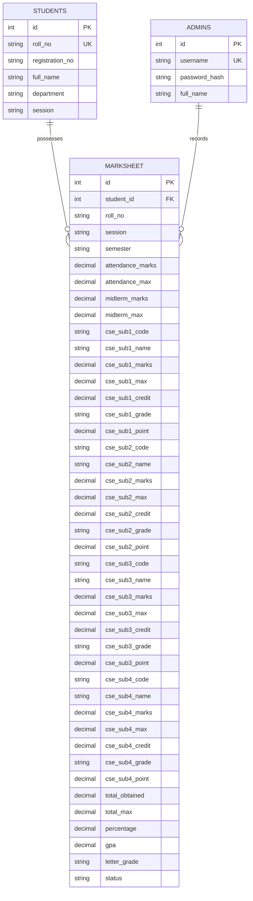

# University Student Marks & Grading System
## System Design, UI/UX & Working Method Documentation

---

## 1. Executive Summary

The **University Student Marks & Grading System** is a lightweight, academic grading portal for Computer Science & Engineering (CSE) departments. It streamlines marks entry for course instructors and examination administrators while providing students with a fast result-query interface.

### Core Objectives
1. **Admin Marks Entry**:
   - Record marks for **Continuous Assessment**: Class Attendance and Midterm Exam.
   - Record marks for **4 CSE Subjects** per semester with credit weighting and course codes.
   - Select students by **Semester dropdown**, **Roll Number**, and **Session dropdown**.
2. **Student Result Portal**:
   - Search by **Semester dropdown**, **Roll Number**, and **Session dropdown**.
   - Inspect **Total Marks**, **Individual Component Marks** (Attendance, Midterm, CSE 4 subjects), and **CGPA / SGPA**.
3. **Clean Architecture**:
   - **Frontend**: Pure HTML, CSS (pure Flexbox layout), and Vanilla JavaScript.
   - **Backend**: Pure PHP REST API (using PDO prepared statements).
   - **Database**: MySQL relational database (`varsity_grading_db`).
   - **Simple & Direct**: Clean Flexbox structure, no animations, inline SVGs (no emojis).

---

## 2. System Architecture & Component Separation

```
+-----------------------------------------------------------------------------------+
|                                 FRONTEND (CLIENT)                                 |
|                                                                                   |
|    +-----------------------------+             +-----------------------------+    |
|    |      Student Search         |             |       Admin Dashboard       |    |
|    |  (frontend/index.html)      |             |  (frontend/admin.html)      |    |
|    |                             |             |                             |    |
|    |  - Session Dropdown         |             |  - Simple Admin Login       |    |
|    |  - Semester Dropdown        |             |  - Marks Entry Form         |    |
|    |  - Roll Number Input        |             |  - Live Calculation Box     |    |
|    |  - Marksheet Card Display   |             |  - Marksheets Records Table |    |
|    +--------------+--------------+             +--------------+--------------+    |
|                   | Pure Vanilla JavaScript (Fetch API)       |                   |
+-------------------|-------------------------------------------|-------------------+
                    | JSON Data Exchange                        |
                    v                                           v
+-----------------------------------------------------------------------------------+
|                                 BACKEND (PHP API)                                 |
|                                                                                   |
|    - get_dropdowns.php  : Populates active sessions, semesters & default courses  |
|    - search_result.php  : Student query endpoint (returns totals, marks & CGPA)   |
|    - admin_login.php    : Controller login & session authorization                |
|    - save_marks.php     : Calculates grades, SGPA/CGPA, and saves to database      |
|    - get_students.php   : Admin table retrieval with filter and search             |
|    - delete_marks.php   : Deletes a marksheet record by ID                        |
|                                                                                   |
|    Helpers & Config:                                                              |
|    - database.php       : PDO database connector with standard port & env options |
|    - grading.php        : University 4.00 grading formula, grade points & standing|
|    - cors.php           : CORS headers and JSON response formatter                |
+-----------------------------------------------------------------------------------+
                                          | PDO Prepared Queries
                                          v
+-----------------------------------------------------------------------------------+
|                                 DATABASE (MySQL)                                  |
|                                                                                   |
|    - admins     : id, username, password_hash, full_name                          |
|    - students   : id, roll_no (UNIQUE), registration_no, full_name, session       |
|    - marksheet  : id, student_id, roll_no, session, semester, attendance_marks,   |
|                   midterm_marks, cse_sub1..4 marks, credits, total_obtained,      |
|                   total_max, percentage, gpa, status                              |
|    - sessions   : session_name ('2021-2022', '2022-2023', etc.)                   |
|    - semesters  : semester_name ('1st Semester' to '8th Semester')                |
+-----------------------------------------------------------------------------------+
```

---

## 3. Database Design & Data Dictionary

### Entity Relationship (ER) Diagram



---

## 4. Academic Grading Scale & Formulas

The grading engine implements the standard university 4.00 Grade Point system:

### 4.1 Grade Mapping Table

| Score Range (%) | Letter Grade | Grade Point ($GP$) | Standing |
| :---: | :---: | :---: | :--- |
| **80% to 100%** | **A+** | **4.00** | Outstanding |
| **75% to 79%** | **A** | **3.75** | Excellent |
| **70% to 74%** | **A-** | **3.50** | Very Good |
| **65% to 69%** | **B+** | **3.25** | Good |
| **60% to 64%** | **B** | **3.00** | Satisfactory |
| **55% to 59%** | **B-** | **2.75** | Above Average |
| **50% to 54%** | **C+** | **2.50** | Average |
| **45% to 49%** | **C** | **2.25** | Marginal Pass |
| **40% to 44%** | **D** | **2.00** | Pass |
| **Below 40%** | **F** | **0.00** | Fail |

---

### 4.2 Calculation Formulas

1. **Total Obtained Marks**:
   $$M_{\text{total}} = M_{\text{att}} + M_{\text{mid}} + \sum_{i=1}^{4} M_{\text{cse}_i}$$

2. **Total Maximum Marks**:
   $$M_{\text{max\_total}} = \text{Max}_{\text{att}} + \text{Max}_{\text{mid}} + \sum_{i=1}^{4} \text{Max}_{\text{cse}_i}$$

3. **Percentage**:
   $$P = \left( \frac{M_{\text{total}}}{M_{\text{max\_total}}} \right) \times 100$$

4. **Semester GPA (SGPA)**:
   $$\text{SGPA} = \frac{\sum_{i=1}^{4} (GP_i \times C_i)}{\sum_{i=1}^{4} C_i}$$
   *(where $C_i$ is the course credit hours, default 3.0 each)*

5. **Cumulative CGPA**:
   $$\text{CGPA} = \frac{\sum_{j=1}^{N} \text{SGPA}_j}{N}$$
   *(average across all recorded semesters for the student)*

---

## 5. UI/UX & Flexbox Layout Structure

### 5.1 Simple Flexbox Layout
- **No Animations**: Instant display and response without keyframe delays.
- **Pure SVG Icons**: Built with lightweight, resolution-independent vector SVGs; no emoji.
- **Flexbox Structure**:
  - `header-inner`: `display: flex; justify-content: space-between; align-items: center;`
  - `search-flex-row`: `display: flex; flex-direction: row; gap: 1rem; flex-wrap: wrap;`
  - `bio-flex-container`: `display: flex; flex-direction: row; flex-wrap: wrap; gap: 0.75rem 1.5rem;`
  - `metrics-flex-row`: `display: flex; flex-direction: row; gap: 1rem; flex-wrap: wrap;`
  - `entry-flex-layout`: `display: flex; flex-direction: row; gap: 1.5rem;` (splits entry form and sticky live preview)
  - `filter-flex-bar`: `display: flex; flex-direction: row; gap: 0.85rem; align-items: flex-end;`

### 5.2 User Workflows

#### Student Search Flow
1. Student navigates to `frontend/index.html`.
2. Selects **Session** (e.g. `2021-2022`), **Semester** (e.g. `5th Semester`), and inputs **Roll Number** (e.g. `CSE-2021-001`).
3. Clicks **Search Result**.
4. The result card displays:
   - Student details (Name, Roll, Reg, Dept, Session, Semester).
   - Summary boxes: Total Marks, Percentage, SGPA, CGPA.
   - Section 1: Attendance and Midterm Marks.
   - Section 2: 4 CSE Subjects with code, title, credits, obtained/max marks, letter grade, and grade point.
   - Section 3: Multi-semester progression (if available).
   - Official 4.00 scale legend.

#### Admin Examination Flow
1. Admin navigates to `frontend/admin.html` and logs in (`admin` / `admin123`).
2. Opens **Marks Entry & Grading Form**:
   - Enters Roll Number, Full Name, selects Session and Semester dropdown.
   - Entering Semester auto-adapts course codes and titles to standard CSE courses.
   - Enters Attendance marks and Midterm marks.
   - Enters marks for CSE Subject 1, 2, 3, and 4.
   - The **Live Calculation box** updates in real-time on every keystroke, calculating Total Marks, %, and SGPA before saving.
   - Clicks **Save Marksheet & Calculate**.
3. Opens **Manage Marksheets**:
   - Filter records by text search, semester, or session.
   - Edit, view, or delete records.

---

## 6. How to Run Locally

### 1. Database Setup
```bash
# Seed the database:
php backend/database/seed.php

# Or import via MySQL:
mysql -u root -p < backend/database/schema.sql
```

### 2. Start the Server
```bash
php -S localhost:8000
```

### 3. Open Portals in Browser
- **Student Search**: `http://localhost:8000/frontend/index.html`
- **Admin Console**: `http://localhost:8000/frontend/admin.html`

### 4. Credentials & Sample Data
- **Admin**: `admin` / `admin123`
- **Test Students**:
  - `CSE-2021-001` (5th Semester, 2021-2022)
  - `CSE-2021-002` (5th Semester, 2021-2022)
  - `101` (3rd Semester, 2021-2022)
